# Visualizations - built 2026-11-08 22:14

Regenerate: `python Outputs/_viz_all.py`

Four-tab HTML record: `Write-up/gemma-agent-score-record.html` (hand-maintained; its score chart is rebuilt from the submission cache by `python Write-up/_rebuild_score_svg.py`, checks: `python Write-up/_check_score_record.py`).

## Board submissions over time
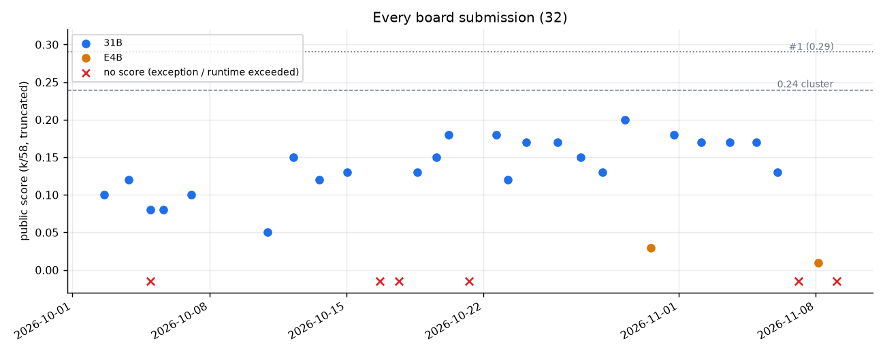

31B ca5 family sits 0.13-0.20; E4B 0.03 / 0.01; x = runs that never scored.

## E4B arms on the 39
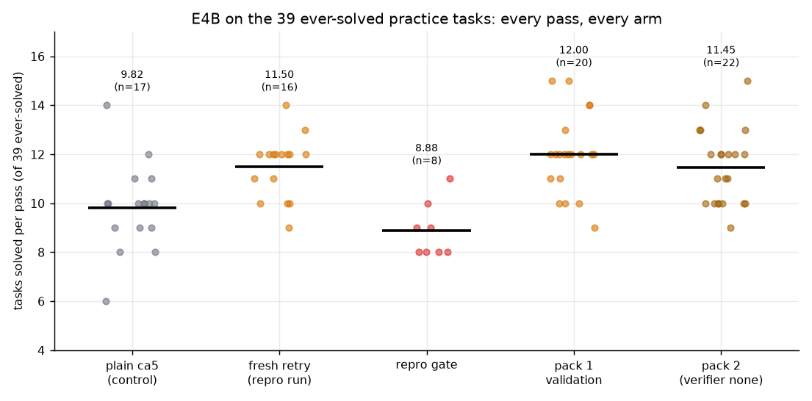

Fresh retry ~11.5-12 vs plain 9.8 locally - but pack 1 scored 0.01 on the board (transfer).

## 31B rounds on 85 live
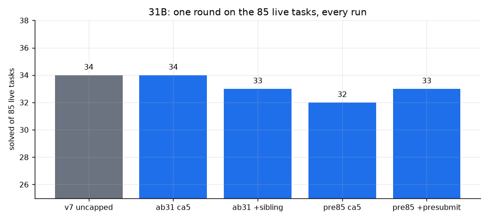

Rock-steady 32-34 regardless of prompt add-ons; uncapped v7 also 34.

## Timeout recovery A/B
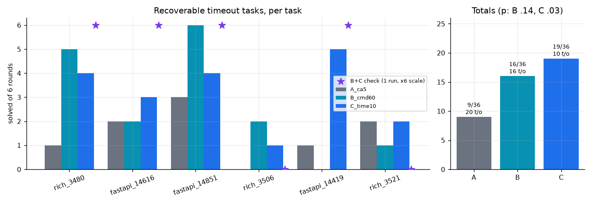

10-min cap converts the time-bound tasks (12 of 19 C solves landed after 8 min).

## 31B server telemetry
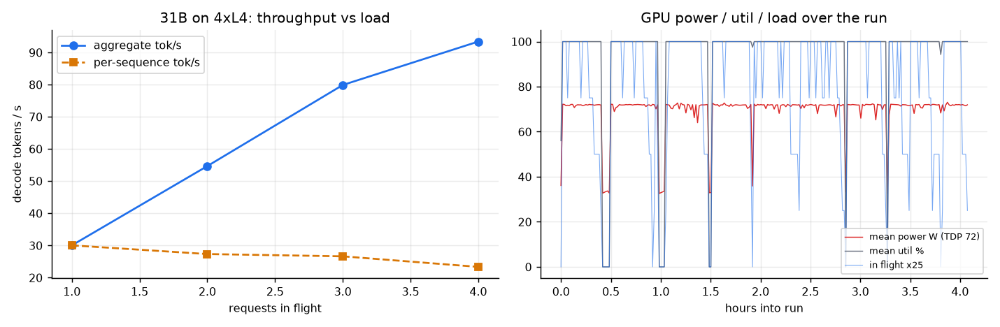

Power-limited at ~69 W; per-sequence speed drops 30 -> 23 tok/s at 4 in flight; chunk tails idle.

## E4B fresh-retry mechanism
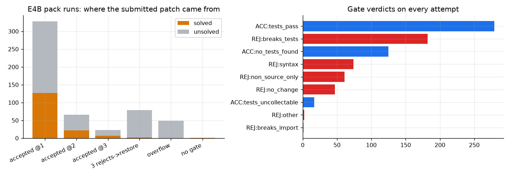

80% of solves are attempt 1; the retry adds 31 conversions, half via the syntax check.

## Practice vs board transfer
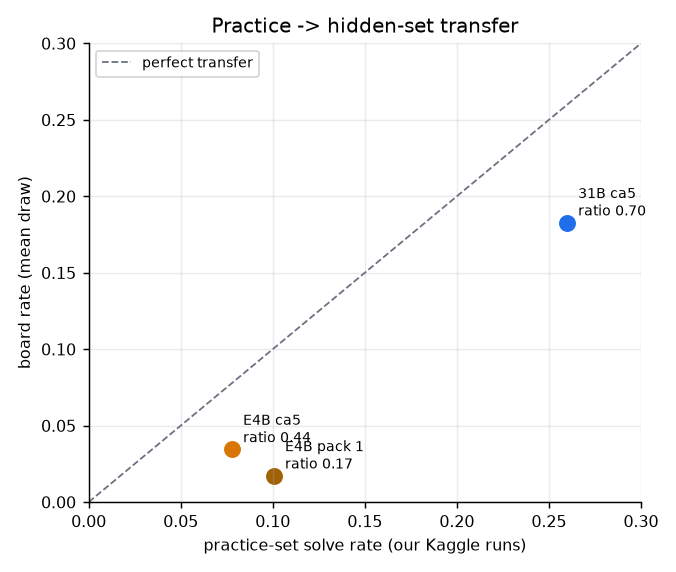

Hidden repos != practice repos (host-confirmed). Weaker model + task-specific gains transfer worst.

## 31B per-task heatmap
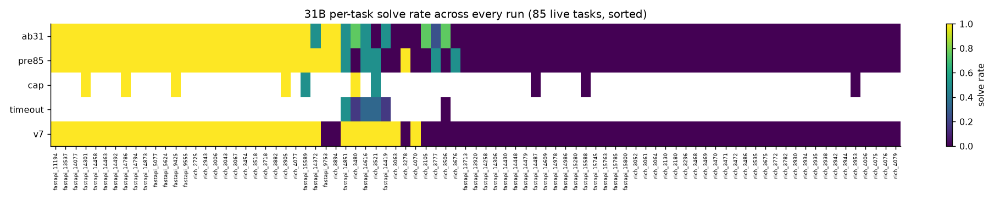

~28 always / ~8 flippy / ~49 never - the flippy middle is where every lever lives.

## 31B model-turn time distribution
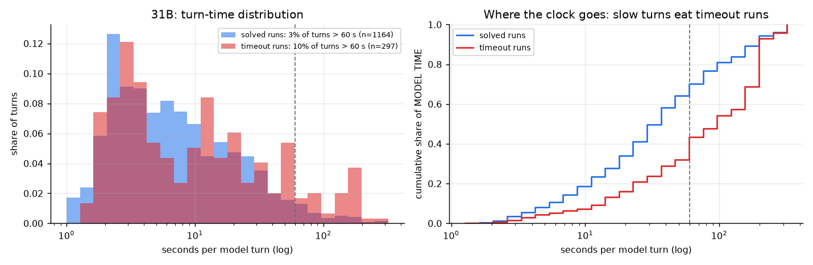

Turns > 60 s are a small share of turns but a large share of the clock in timeout runs; they carry ~10k chars of text before a run_command.

## Board history by phase (paper Fig. 1)
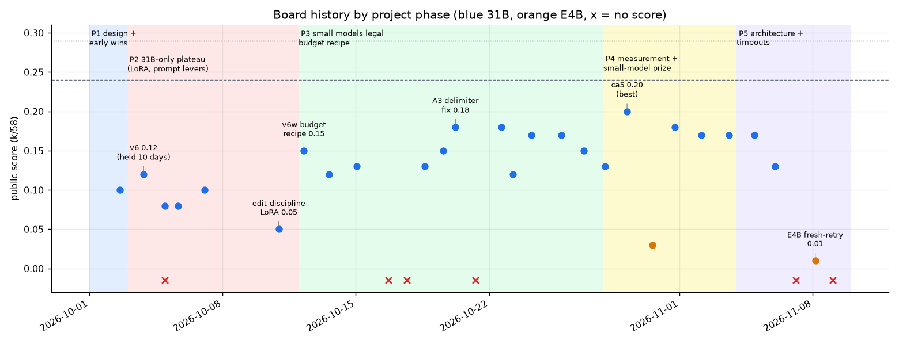

Fast start, a 10-day plateau during the 31B-only/LoRA phase, then steady gains after the small-model release changed what we could iterate on.

## Model-size ladder
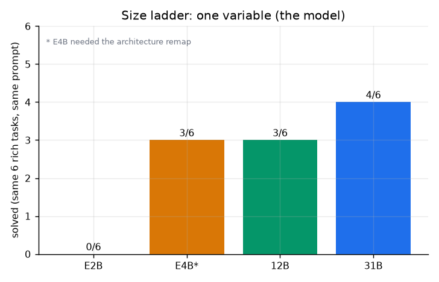

Identical v6w prompt + 6 rich tasks: 31B 4, 12B 3, E4B 3, E2B 0 (log L11433-11452). Tiny n - it showed small models were viable proxies, not that they match the 31B.

